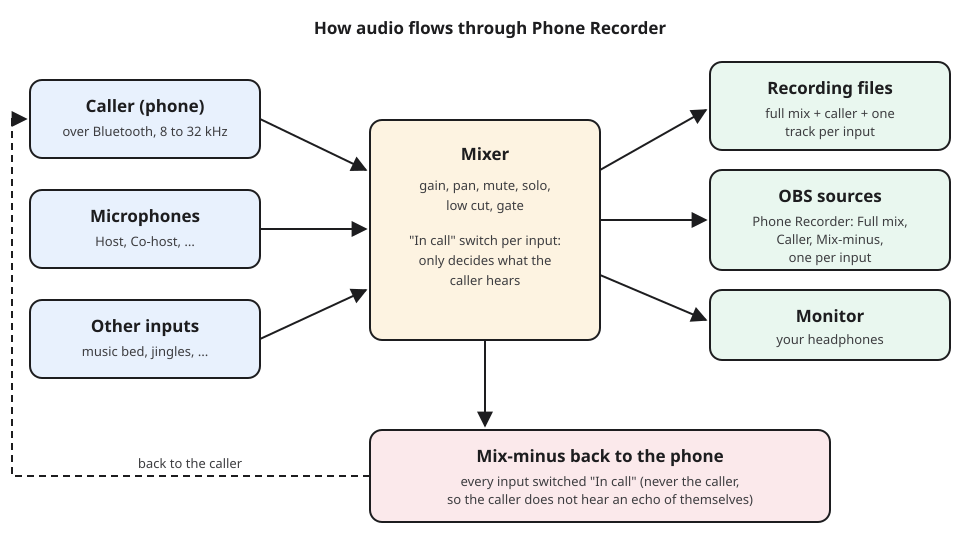
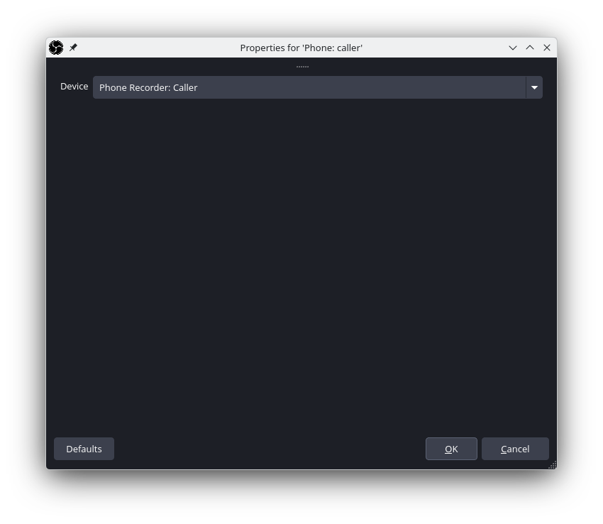
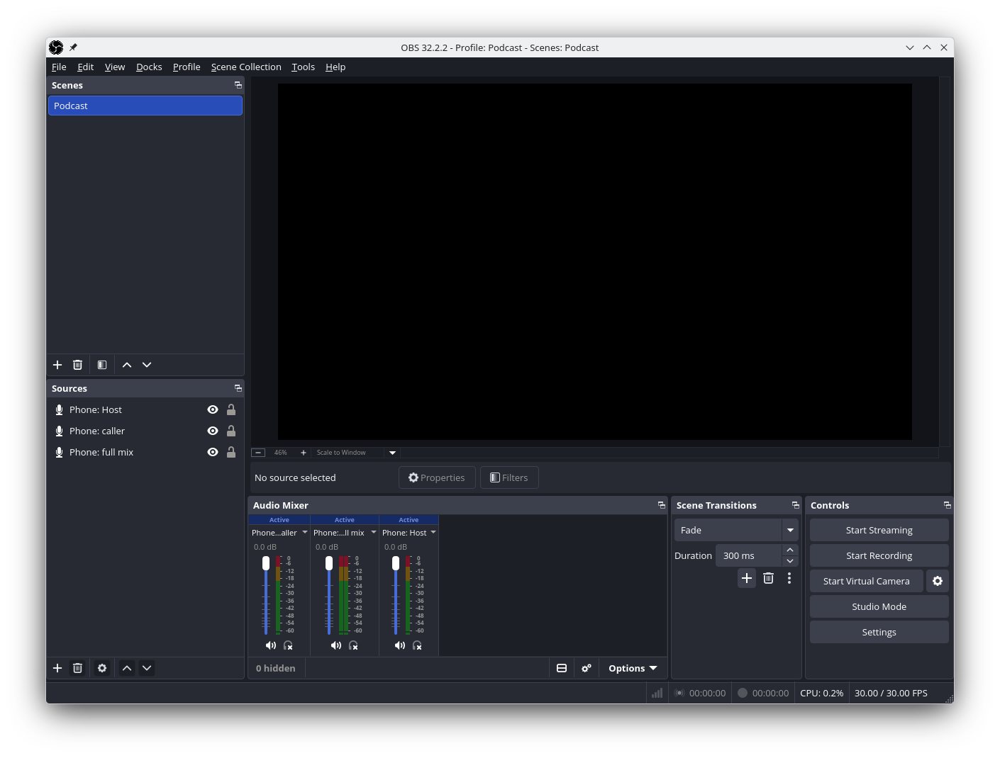
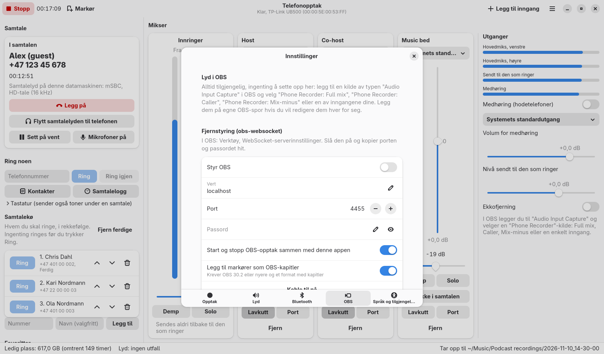

# Bruke Telefonopptak med OBS Studio

Telefonopptak og OBS virker sammen på to måter, og du kan bruke den ene eller
begge:

1. **Lydkilder (alltid på):** mens Telefonopptak kjører, dukker lyden opp i OBS
   som vanlige inngangsenheter. Ingenting trenger å settes opp i
   Telefonopptak.
2. **Fjernstyring (valgfritt):** Telefonopptak starter og stopper opptaket i
   OBS sammen med sitt eget, og legger til markørene sine som kapitler i OBS.

Skrevet for OBS Studio 30 og nyere på Linux. Menynavnene er fra OBS på engelsk,
og står derfor på engelsk her.

---

## 1. Lydkildene

Mens Telefonopptak kjører, finnes disse kildene på systemet ditt:

| Kildenavn i OBS | Hva du hører |
|--------------------|---------------|
| **Phone Recorder: Full mix** | den ferdige stereomiksen: den som ringer og alle innganger |
| **Phone Recorder: Caller** | bare den som ringer |
| **Phone Recorder: Mix-minus** | det den som ringer hører (alle innganger som står på «I samtalen») |
| **Phone Recorder: *navn på inngang*** | én per inngang, for eksempel «Phone Recorder: Host» |

Hver kilde for en enkelt inngang har med den inngangen **uansett hva Demp eller
«I samtalen» står på**, så du kan dempe en mikrofon for den som ringer og
likevel ha den i OBS.

### Legg til en kilde

1. Start Telefonopptak først, så kildene finnes.
2. I OBS klikker du på **+** i panelet **Sources** (kilder) og velger
   **Audio Input Capture (PulseAudio)** (lydinngang). (På systemer med
   PipeWire er dette fortsatt riktig valg; PipeWire svarer på vegne av
   PulseAudio.)
3. Gi den et navn, for eksempel «Telefon: innringer», og klikk **OK**.
4. Under **Device** (enhet) velger du den Phone Recorder-kilden du vil ha, og
   så **OK**.

Kilden dukker opp i **Audio Mixer** (lydmikseren) i OBS med egen måler og eget
volum:

### Hvilket oppsett bør jeg velge?

**Enkelt (ett spor):** legg bare til **Phone Recorder: Full mix**. Da får du
den samme miksen som `01-full-mix.wav` fra Telefonopptak, klar til en video.

**For redigering senere (flere spor):** legg til **Phone Recorder: Caller** og
én kilde per inngang (for eksempel **Phone Recorder: Host**), og legg hver av
dem på sitt eget lydspor i OBS:

1. **Edit, Advanced Audio Properties** (avanserte lydegenskaper), eller
   tannhjulikonet i Audio Mixer.
2. Kryss av bare for kildens eget spor: den som ringer på spor 2, verten på
   spor 3 og så videre. Behold hovedmiksen på spor 1 hvis du også vil ha en
   ferdig miks.
3. Under **Settings, Output** (innstillinger, utdata) setter du **Output
   Mode** til **Advanced**, åpner fanen **Recording** og krysser av for de
   samme numrene under **Audio Track**.
4. Ta opp til **MKV** eller **Hybrid MP4**: begge beholder flere lydspor.

Opptaket i Telefonopptak har allerede disse sporene som egne WAV-filer, så
sporene i OBS er mest nyttige når du redigerer videoen i et
videoredigeringsprogram.

### Unngå dobbel lyd

Fang hver lyd bare én gang:

- Legg **ikke** til mikrofonen din direkte i OBS i tillegg når den allerede er
  en inngang i Telefonopptak; bruk «Phone Recorder: *navn på inngang*» i
  stedet.
- **Desktop Audio** (skrivebordslyd) i OBS fanger alt datamaskinen spiller,
  også medhøringen fra Telefonopptak. Bruker du Phone Recorder-kildene, demper
  eller slår du av Desktop Audio (**Settings, Audio, Global Audio Devices,
  Desktop Audio: Disabled**), eller du spiller medhøringen på en enhet som OBS
  ikke fanger.

### Hva er mix-minus til?

**Phone Recorder: Mix-minus** er nøyaktig det den som ringer hører. Den er
nyttig når en gjest til blir med gjennom en annen app (for eksempel en
videosamtale): send mix-minus til den appen som mikrofon, så gjesten hører deg
og den som ringer på telefonen, men ikke seg selv.

---

## 2. Fjernstyring (start og stopp sammen)

Med fjernstyring på starter **Ta opp** i Telefonopptak også opptaket i OBS,
**Stopp** stopper begge, og hver **Markør** blir et kapittel i OBS.

### I OBS

1. **Tools, WebSocket Server Settings** (verktøy, innstillinger for
   WebSocket-serveren).
2. Kryss av for **Enable WebSocket server**.
3. Noter **Server Port** (vanligvis 4455). Klikk **Show Connect Info** for å
   se passordet, eller velg ditt eget.
4. Klikk **OK**.

### I Telefonopptak

1. **Hovedmeny (☰), Innstillinger, OBS.**
2. Slå på **Styr OBS**.
3. Fyll inn **Vert** (`localhost` når OBS kjører på samme datamaskin), **Port**
   og **Passord**, og trykk Enter etter hvert felt.
4. Velg **Koble til nå**. Meldingen «Koblet til OBS» bekrefter det.

Valg:

- **Start og stopp OBS-opptak sammen med denne appen.**
- **Legg til markører som OBS-kapitler.** Krever OBS 30.2 eller nyere og
  opptaksformatet **Hybrid MP4**, som støtter kapitler.

Hvis OBS er lukket, fortsetter Telefonopptak å virke på egen hånd. Velg
**Koble til nå** igjen når du har startet OBS.

---

## 3. Sjekkliste for en opptaksøkt

1. Start Telefonopptak; sjekk at telefonen er tilkoblet (**Telefon**-delen).
2. Start OBS; sjekk at Phone Recorder-kildene viser utslag i Audio Mixer når
   noen snakker.
3. Snakk i hver mikrofon og still nivået i Telefonopptak til omtrent -12 dB.
4. Ring eller svar på samtalen; sjekk kodeken som vises i samtalekortet
   («HD-tale» eller bedre er bra).
5. Trykk **Ta opp** i Telefonopptak. Med fjernstyring på starter OBS også.
6. Legg til markører (Ctrl+M eller F9) der du vil finne igjen noe senere.
7. Trykk **Stopp**. Telefonopptak viser hvor filene ligger; OBS lagrer sitt
   opptak som vanlig.

## Feilsøking

| Problem | Hva du gjør |
|---------|------------|
| Phone Recorder-enhetene mangler i OBS | Start Telefonopptak før du åpner egenskapene for kilden, og åpne så **Device**-listen på nytt. |
| En OBS-kilde viser ikke utslag | Sjekk at den tilhørende kanalen i Telefonopptak viser nivå. Merk at Demp ikke gjør kilder for enkeltinnganger stille, men hovedmiksen følger Demp. |
| Alt er dobbelt så høyt eller har ekko i OBS | En lyd fanges to ganger: se [Unngå dobbel lyd](#unngå-dobbel-lyd). |
| «OBS: wrong OBS websocket password» (feil passord) | Kopier passordet på nytt fra **Tools, WebSocket Server Settings, Show Connect Info**. |
| «OBS: disconnected from OBS» (frakoblet) | OBS ble lukket, eller WebSocket-serveren er av. Start OBS, og velg så **Koble til nå**. |
| Ingen kapitler i OBS-opptaket | Bruk OBS 30.2 eller nyere og formatet Hybrid MP4. |
