# Brukerveiledning for Telefonopptak

Telefonopptak tar opp telefonsamtaler over Bluetooth til podkaster. Datamaskinen
kobler seg til telefonen slik et bilsett gjør, så alle samtaler på telefonen går
gjennom appen: vanlige samtaler og ringeapper som WhatsApp eller Signal.
Den som ringer og hver mikrofon tas opp på egne spor, og alle er også
tilgjengelige i OBS.

Innhold:

1. [Dette trenger du](#1-dette-trenger-du)
2. [Første oppstart: velg Bluetooth-adapter](#2-første-oppstart-velg-bluetooth-adapter)
3. [Par telefonen](#3-par-telefonen)
4. [Hovedvinduet](#4-hovedvinduet)
5. [Samtaler](#5-samtaler)
   - [Sett på vent og mikrofoner av](#sett-på-vent-og-mikrofoner-av)
   - [Kontakter](#kontakter)
   - [Favoritter](#favoritter)
   - [Samtalekø](#samtalekø)
   - [Samtalelogg](#samtalelogg)
6. [Mikseren](#6-mikseren)
7. [Opptak](#7-opptak)
8. [Innstillinger](#8-innstillinger)
9. [Hurtigtaster](#9-hurtigtaster)
10. [Tilgjengelighet og språk](#10-tilgjengelighet-og-språk)
11. [Feilsøking](#11-feilsøking)
12. [Hvor filene lagres](#12-hvor-filene-lagres)

Bruker du OBS? Se den egne [OBS-veiledningen](obs-guide.md).

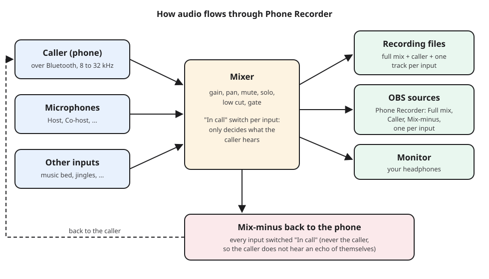

---

## 1. Dette trenger du

- **En Linux-datamaskin** med PipeWire (standard i dagens distribusjoner).
- **En Bluetooth-adapter.** En egen USB-dongle er best, fordi appen tar full
  kontroll over adapteren den bruker: andre Bluetooth-enheter på den adapteren
  (hodetelefoner, mus, tastatur) kobles fra mens appen kjører. Et billig valg
  som virker godt, er TP-Link UB500. Den innebygde adapteren virker også.
  Se maskinvaretabellen i [README](../../README.md#bluetooth-adapters).
- **Hodetelefoner** til medhøring. Med høyttalere kan den som ringer høre ekko
  (det finnes ekkofjerning for det tilfellet, se [mikseren](#6-mikseren)).
- **Engangsoppsett** (spør etter passordet ditt):

  ```sh
  scripts/install-udev-rule.sh
  ```

  Dette lar brukeren din styre USB-Bluetooth-adaptere uten root-rettigheter.
  Hvordan du bygger og installerer appen, står i [BUILD.md](../../BUILD.md).

### Hvilke telefoner som virker

Alle telefoner som virker med et bilsett eller et Bluetooth-headset:
Android-telefoner, iPhone og de fleste andre mobiltelefoner (Bluetooth
Hands-Free Profile). Kontaktlisten krever at telefonen deler adresseboken sin
(Phone Book Access Profile), noe Android-telefoner og iPhone gjør når du har
tillatt det. Noen eldre telefoner kan ikke dette, og da virker appen helt fint
uten kontakter.

### Om lydkvaliteten

Bluetooth-samtaler begrenses av selve forbindelsen til telefonen, uansett hva
appen tar opp med:

| Vises under samtalen | Samplingsfrekvens | Vanlige telefoner               |
|-----------------------|-------------|---------------------------------|
| CVSD, smalbånd        | 8 kHz       | gamle telefoner eller adaptere  |
| mSBC, HD-tale         | 16 kHz      | de fleste telefoner fra de siste ti årene |
| LC3-SWB, superbredbånd | 32 kHz     | nyere telefoner                 |

Appen velger den beste som både telefonen og adapteren støtter. Dine egne
mikrofoner tas opp i full kvalitet (48 kHz, 32 bit).

---

## 2. Første oppstart: velg Bluetooth-adapter

Første gang appen starter, spør den hvilken Bluetooth-adapter den skal bruke.

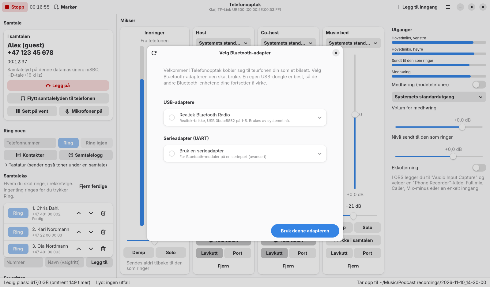

1. Velg adapteren din. Hver oppføring viser brikken, USB-ID-en og om systemet
   bruker den akkurat nå.
2. Valgfritt: åpne oppføringen for å velge **Modus**:
   - **Direkte USB (anbefalt):** appen snakker med adapteren selv og laster
     fastvaren.
   - **Kjernedriver, rå tilgang:** for brikker der bare Linux-kjernen kan laste
     fastvaren (MediaTek, Intel AX210 og nyere, Qualcomm). Krever
     hjelpeprogrammet: kjør `scripts/setup-userchan-helper.sh` én gang.
3. Velg **Bruk denne adapteren**. Hvis systemet bruker den, advarer appen
   først om at andre Bluetooth-enheter på den blir koblet fra. Deretter starter
   appen på nytt én gang.

Mens appen kjører, tilhører adapteren appen. Når du lukker appen, får systemet
den tilbake, også hvis appen skulle krasje.

Slik bytter du adapter senere: **Hovedmeny (☰), Velg Bluetooth-adapter**.

---

## 3. Par telefonen

1. Slå på **Paringsmodus** i **Telefon**-delen.
2. Åpne Bluetooth-innstillingene på telefonen og velg navnet til appen
   (som standard «Phone Recorder», se [Bluetooth-navn](#bluetooth-navn)).
3. Appen viser en kode. Sjekk at telefonen viser **den samme koden**, og velg
   så **Par** både på telefonen og på datamaskinen.

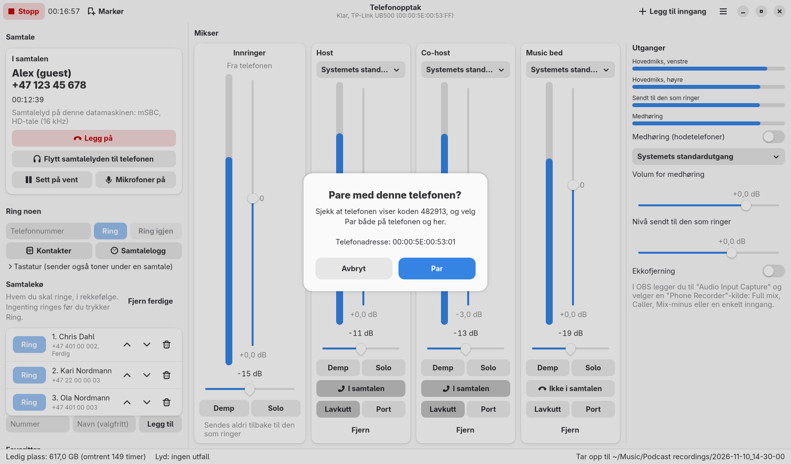

Eldre telefoner kan be om en PIN-kode i stedet. Skriv den samme koden på begge
sider, for eksempel 0000:

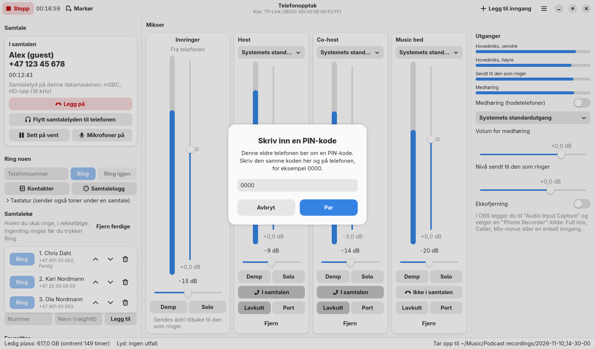

Etter paringen vises telefonen under **Parede telefoner**. Neste gang kobler
den seg til av seg selv når appen starter (eller bruk **Koble til** i listen).
**Glem** (søppelbøtteikonet) fjerner en telefon; den må da pares på nytt.

### Bluetooth-navn

Navnet telefonene ser, kan endres i **Telefon**-delen: velg feltet
**Bluetooth-navn**, skriv et nytt navn og trykk Enter. Det endres med en gang.
Telefoner som allerede er paret, kan vise det gamle navnet til de kobler til
igjen.

---

## 4. Hovedvinduet


- **Toppfeltet:** **Ta opp** / **Stopp** med opptakstiden, **Markør**,
  **Legg til inngang** og hovedmenyen (☰). Undertittelen viser
  Bluetooth-statusen.
- **Venstre side:** den pågående samtalen, **Ring noen**, **Telefon**-delen
  (tilkobling, batteri, signal, Bluetooth-navn, paringsmodus) og **Parede
  telefoner**.
- **Høyre side:** **Mikser** med én kanal per kilde og **Utganger**-delen.
- **Statuslinjen nederst:** ledig diskplass med hvor lang opptakstid som er
  igjen, en indikator for lydhelse («ingen utfall» eller et antall) og hvor
  det pågående opptaket lagres.

---

## 5. Samtaler

- **Innkommende anrop:** samtalekortet viser navnet eller nummeret til den som
  ringer, og **Svar** og **Avvis** (Ctrl+Shift+A, Ctrl+Shift+H). Hvis vinduet
  ligger i bakgrunnen, kommer det et skrivebordsvarsel med en Svar-knapp.
- **Ring noen:** skriv nummeret under **Ring noen** og trykk Enter eller
  **Ring**. **Ring igjen** ringer det siste nummeret på nytt. **Tastatur**
  sender toner under en samtale (for menyer som «trykk 1»).
- **Under samtalen:** kortet viser samtaletiden og kodeken, for eksempel
  «mSBC, HD-tale (16 kHz)». **Legg på** avslutter samtalen.
- **Samtalelyd på telefonen eller datamaskinen:** **Flytt samtalelyden til
  telefonen** gir lyden tilbake til telefonen (samtalen fortsetter);
  **Flytt samtalelyden til datamaskinen** henter den tilbake (Ctrl+Shift+T).
  Appen henter lyden til datamaskinen av seg selv når en samtale starter.
- **Samtale venter:** hvis det kommer en ny samtale mens du er i en samtale,
  viser kortet «Samtale venter» med navnet eller nummeret til den nye som
  ringer, og under det samtalen du er i. **Svar** setter den pågående samtalen
  på vent og tar den nye; **Avvis** avviser bare den nye samtalen.

Lukker du appen under en samtale, avsluttes ikke samtalen; den fortsetter på
telefonen.

### Sett på vent og mikrofoner av

Under en samtale dukker det opp to knapper til i samtalekortet:

- **Sett på vent** (Ctrl+Shift+P) setter samtalen på vent; kortet viser
  «På vent». **Fortsett** tar den tilbake. Dette bruker telefonens egen
  ventefunksjon, så den som ringer hører det telefonen eller nettet spiller
  for samtaler på vent. Noen få telefoner kan ikke sette én enkelt samtale på
  vent; de sier da fra om det.
- **Mikrofoner på / Mikrofoner av** (Ctrl+Shift+M) bestemmer om den som ringer
  hører mikrofonene dine i det hele tatt, for eksempel når du vil snakke med en
  medprogramleder utenom sending. OBS, opptaket og hodetelefonene dine beholder
  mikrofonene uansett. Den slås alltid på igjen når neste samtale starter. Vil
  du slå enkeltinnganger av og på, bruker du knappene **I samtalen** i mikseren.

### Kontakter

Når en telefon kobler seg til, henter appen adresseboken fra den, så du kan
ringe folk ved navn og se hvem som ringer, selv når telefonen bare sender et
nummer. Kontaktene lagres bare på denne datamaskinen, i en fil som bare brukeren
din kan lese, og slettes når du velger **Glem** for telefonen.

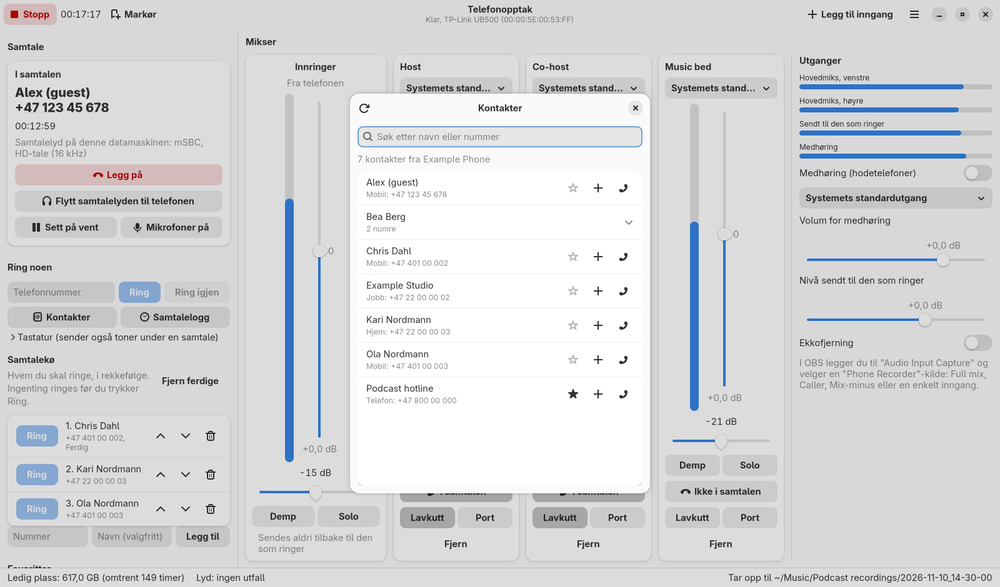

- Åpne det med **Kontakter** under **Ring noen**, eller Ctrl+K.
- Skriv i søkefeltet for å finne et navn eller en del av et nummer.
- Klikk på ringeknappen ved et nummer for å ringe det. Kontakter med flere
  numre kan åpnes så du ser alle.
- Oppdater-knappen (øverst til venstre) henter adresseboken på nytt.

Telefonen må tillate dette første gang:

- **Android:** telefonen spør om den skal dele kontakter (og samtalehistorikk)
  med «Phone Recorder»: velg **Tillat**. Gikk du glipp av spørsmålet, åpner du
  Bluetooth-innstillingene på telefonen, trykker på tannhjulet ved Phone
  Recorder og slår på **Kontakter** (noen ganger kalt **Kontaktdeling**).
- **iPhone:** åpne **Innstillinger, Bluetooth**, trykk på **(i)** ved Phone
  Recorder og slå på **Synkroniser kontakter**. Velg så Oppdater i vinduet
  Kontakter.

Vil du ikke lenger hente kontakter, slår du av **Hent kontaktene fra
telefonen** under Innstillinger, Bluetooth.

### Favoritter

De du ringer oftest. Klikk på stjernen ved et nummer i **Kontakter** eller
**Samtalelogg** for å legge til eller fjerne en favoritt. Favorittene vises i
hovedvinduet, hver med en ringeknapp og en knapp for å legge dem i samtalekøen.

### Samtalekø

En liste over hvem du skal ringe, i rekkefølge, for eksempel gjestene i dagens
episode. **Køen ringer aldri av seg selv**: du starter hver samtale med dens
egen **Ring**-knapp, når du er klar.

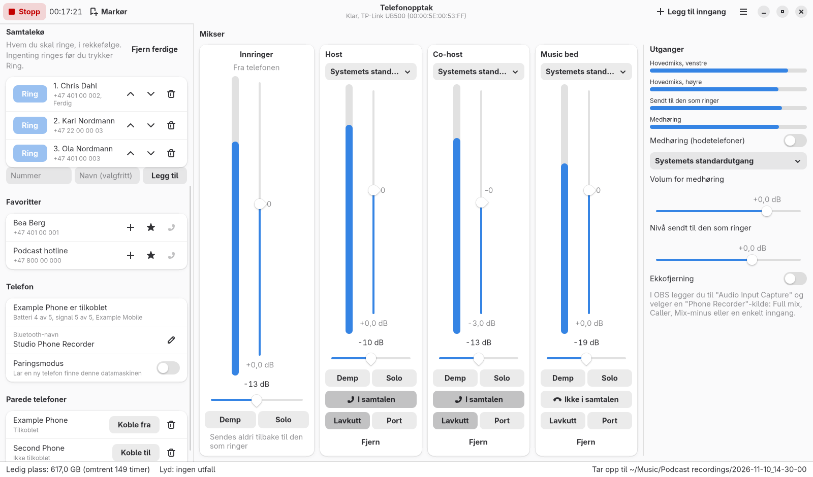

- Legg til noen: skriv nummeret (og et navn om du vil) i feltene i køen og
  trykk **Legg til**, eller bruk **+**-knappen ved en kontakt, en favoritt
  eller en oppføring i samtaleloggen.
- Endre rekkefølgen med pil opp og pil ned; fjern en oppføring med
  søppelbøtta.
- Når noen svarer på en samtale du startet fra køen, merkes oppføringen
  **Ferdig**. **Fjern ferdige** fjerner disse.
- Køen tas vare på når du lukker appen.

### Samtalelogg

**Samtalelogg** (under **Ring noen**, eller Ctrl+L) viser samtalene som er
ringt og mottatt gjennom Telefonopptak, nyeste først: innkommende, utgående,
tapte og avviste, med dato, klokkeslett og hvor lenge dere snakket. Fra hver
oppføring kan du ringe tilbake, stjernemerke den som favoritt eller legge den
i køen. **Tøm** sletter loggen fra denne datamaskinen (telefonens egen
samtalehistorikk blir ikke rørt).

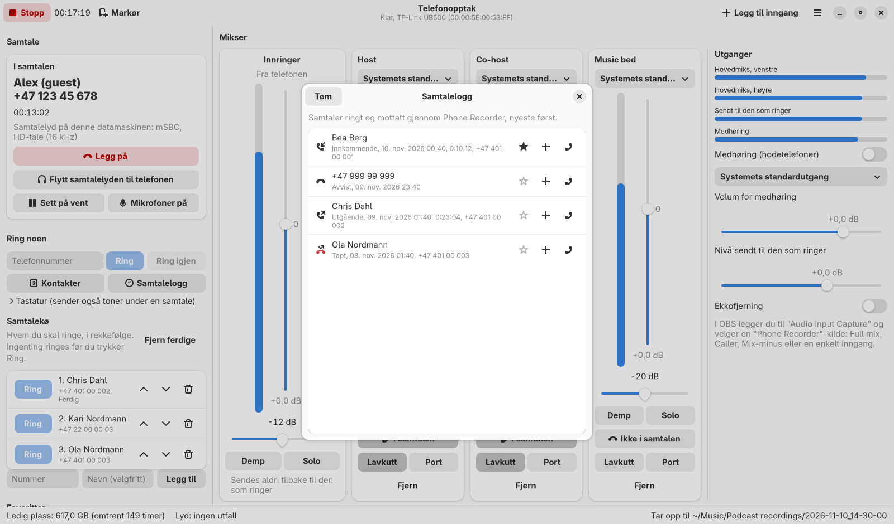

---

## 6. Mikseren

Hver kilde har en kanal. Kanalen **Innringer** kommer alltid først.

| Kontroll | Hva den gjør |
|---------|--------------|
| Navn (klikk for å gi nytt navn) | Brukes på opptaksfilen og i navnet på OBS-kilden. |
| Inngangsenhet | Hvilken mikrofon eller inngang kanalen bruker. «Systemets standardinngang» følger innstillingen på skrivebordet ditt. |
| Nivåmåler og tall | Toppnivå. Sikt på omtrent -12 dB når du snakker. «KLIPP» betyr for høyt: skru ned volumet. |
| Volumglidebryter | Forsterkning for kanalen, -30 til +24 dB. |
| Venstre-høyre-glidebryter | Plassering i stereomiksen. |
| **Demp** | Tar kanalen ut av miksen og samtalen. Dens egen OBS-kilde og opptaksspor beholder lyden. |
| **Solo** | Lytt bare til solo-kanaler på medhøringen. Endrer ingenting i opptaket, samtalen eller OBS. |
| **I samtalen / Ikke i samtalen** | Om den som ringer hører denne inngangen. **Den fjerner aldri inngangen fra OBS eller opptaket.** |
| **Lavkutt** | Fjerner rumling og håndteringsstøy under 80 Hz. |
| **Port** | Skrur ned kanalen når ingen snakker i den. |
| **Fjern** | Fjerner inngangen (ikke mulig under opptak). |

Den som ringer sendes **aldri** tilbake til telefonen, så den som ringer hører
aldri ekko av seg selv. Dette kalles en mix-minus.

**Legg til inngang** (Ctrl+I) legger til en mikrofon eller inngang til, for
eksempel en musikkspiller du vil ha på eget spor.

### Utganger

- **Målere:** hovedmiksen (venstre og høyre), det som sendes til den som
  ringer, og medhøringen.
- **Medhøring (hodetelefoner):** slå på, velg utgangsenhet og still inn
  volumet. Medhøringen spiller hele miksen, eller bare solo-kanalene.
- **Nivå sendt til den som ringer:** samlet volum på det den som ringer hører.
- **Ekkofjerning:** trengs bare når den som ringer spilles på høyttalere.

---

## 7. Opptak

- Trykk **Ta opp** (Ctrl+R) for å starte og **Stopp** for å avslutte. En
  melding forteller hvor opptaket ble lagret, med en **Åpne mappen**-knapp.
- Hvert opptak får sin egen mappe, oppkalt etter dato og klokkeslett, for
  eksempel `~/Music/Podcast recordings/2026-11-10_14-30-00/`.
- Inni ligger én fil per kilde, alle helt i takt:

  ```
  01-full-mix.wav        the stereo mix
  02-caller.wav          the caller
  03-host.wav            each input, named after its strip
  04-co-host.wav
  markers-audacity.txt   markers for Audacity (File, Import, Labels)
  chapters.txt           markers as chapter times
  ```

- **Markører** (Ctrl+M eller F9) merker et punkt i opptaket, for eksempel et
  godt sitat. De lagres i WAV-filene som cue-punkter, som en etikettfil for
  Audacity og som en kapittelliste.
- **Automatisk opptak:** i Innstillinger kan du velge at opptaket starter av
  seg selv når en samtale starter, og stopper når den slutter.
- Opptakene er trygge hvis datamaskinen krasjer eller mister strømmen: filene
  kan leses helt fram til siste øyeblikk.
- Statuslinjen advarer når det er mindre enn 15 minutter diskplass igjen.

Innganger kan ikke legges til eller fjernes under opptak.

---

## 8. Innstillinger

Åpne med **Hovedmeny (☰), Innstillinger** eller Ctrl+komma.

### Opptak

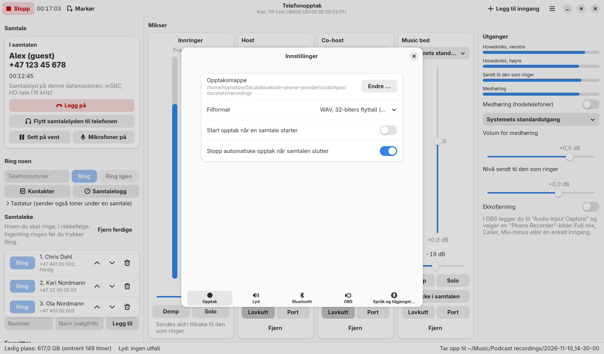

- **Opptaksmappe.**
- **Filformat:** WAV 32-biters flyttall (best for redigering, standard), WAV
  24-biters, FLAC 24-biters (tapsfri, omtrent halve størrelsen) eller Opus
  (liten, for deling).
- **Start opptak når en samtale starter** og **Stopp automatiske opptak når
  samtalen slutter.**

### Lyd

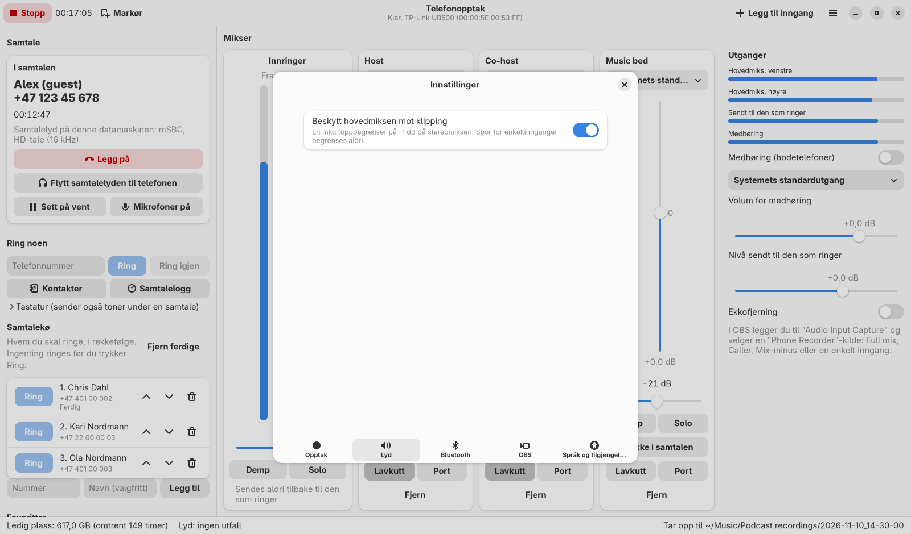

- **Beskytt hovedmiksen mot klipping:** en mild begrenser på stereomiksen.
  Spor for enkeltinnganger begrenses aldri.

### Bluetooth

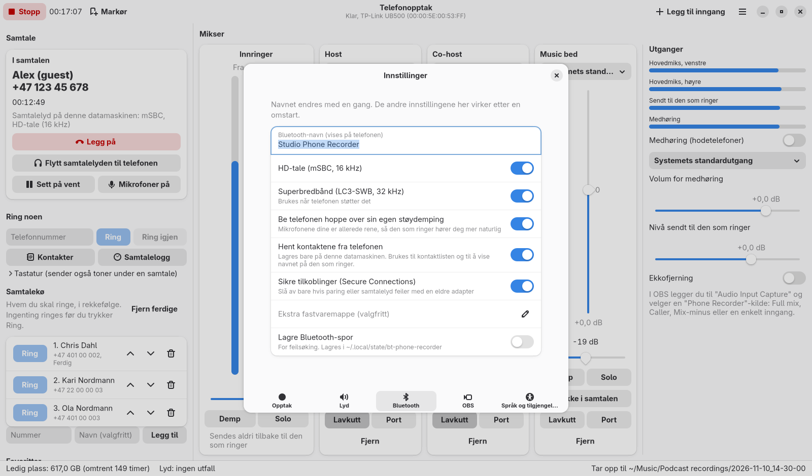

- **Bluetooth-navn** (endres med en gang).
- **HD-tale** og **Superbredbånd:** tillater de bedre kodekene. La dem være på.
- **Be telefonen hoppe over sin egen støydemping:** mikrofonene dine er
  allerede rene, så den som ringer hører deg mer naturlig.
- **Hent kontaktene fra telefonen:** se [Kontakter](#kontakter).
- **Sikre tilkoblinger (Secure Connections):** slå av bare hvis paring eller
  samtalelyd feiler med en eldre adapter.
- **Ekstra fastvaremappe:** for adaptere der fastvaren ikke finnes i systemet.
- **Lagre Bluetooth-spor:** for feilsøking (se nedenfor).

Bortsett fra navnet virker disse etter en omstart.

### OBS

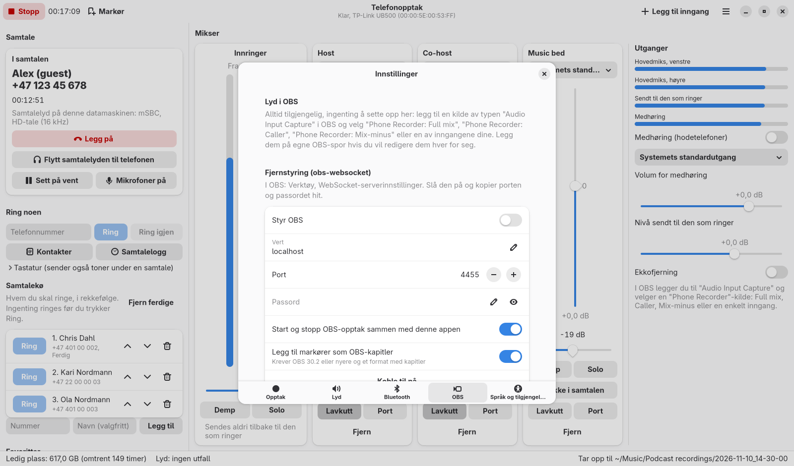

Se [OBS-veiledningen](obs-guide.md).

### Språk og tilgjengelighet

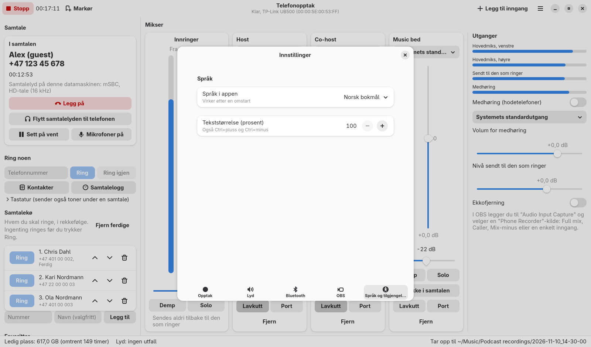

- **Språk i appen:** Systemets standard, English eller Norsk bokmål. Virker
  etter en omstart; meldingen som dukker opp, har en **Start på nytt
  nå**-knapp.
- **Tekststørrelse:** 100 til 200 prosent, i tillegg til innstillingen på
  skrivebordet ditt.

---

## 9. Hurtigtaster

Trykk F1 (eller Ctrl+?) for å se dem i appen.

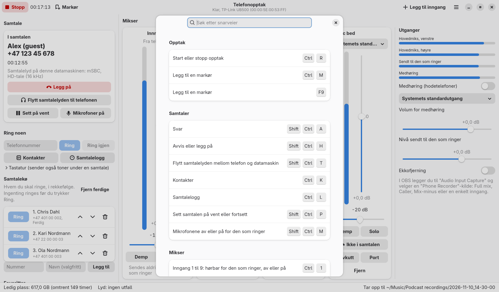

| Taster | Handling |
|------|--------|
| Ctrl+R | Start eller stopp opptak |
| Ctrl+M eller F9 | Legg til en markør |
| Ctrl+Shift+A | Svar |
| Ctrl+Shift+H | Avvis eller legg på |
| Ctrl+Shift+T | Flytt samtalelyden mellom telefon og datamaskin |
| Ctrl+K | Kontakter |
| Ctrl+L | Samtalelogg |
| Ctrl+Shift+P | Sett samtalen på vent eller fortsett |
| Ctrl+Shift+M | Mikrofonene av eller på for den som ringer |
| Ctrl+1 til Ctrl+9 | Inngang 1 til 9: hørbar for den som ringer, av eller på |
| Alt+1 til Alt+9 | Inngang 1 til 9: demping av eller på |
| Ctrl+I | Legg til en inngang |
| Ctrl+komma | Innstillinger |
| Ctrl+pluss, Ctrl+minus, Ctrl+0 | Større tekst, mindre tekst, normal tekststørrelse |
| F10 | Hovedmeny |
| Ctrl+Q | Avslutt |

Alt annet virker med Tab, Shift+Tab, piltastene, Enter, mellomrom og Esc.

---

## 10. Tilgjengelighet og språk

- Alle kontroller har et navn for skjermlesere, og viktige hendelser leses
  opp: innkommende anrop, samtale koblet til og avsluttet, opptak startet og
  stoppet, paringskoder.
- Ingenting er avhengig av farge alene: brytere viser tekst og ikoner, målere
  viser tall.
- Tekststørrelse og språk finner du i Innstillinger (se over).
- Hele erklæringen, på engelsk og norsk, står i
  [ACCESSIBILITY.md](../../ACCESSIBILITY.md).

---

## 11. Feilsøking

| Problem | Hva du gjør |
|---------|------------|
| Telefonen finner ikke appen | Slå på **Paringsmodus**, og søk på nytt fra telefonen. |
| «Fant ikke den valgte Bluetooth-adapteren» | Koble til adapteren, eller velg en annen i **Velg Bluetooth-adapter**. |
| «Adapteren feilet» | Lagre en adapterrapport (**Hovedmeny, Lagre adapterrapport**) og prøv den andre modusen for adapteren, eller en annen adapter. |
| En samtale kobles til, men det kommer ingen lyd | Appen sier fra om det. I kjernedriver-modus kan du prøve Direkte USB. Ellers prøver du en annen adapter. |
| Bare smalbånd (8 kHz) | Adapteren eller telefonen støtter ikke bredbånd. Prøv en annen adapter. |
| Den som ringer hører ekko | Bruk hodetelefoner, eller slå på **Ekkofjerning**. |
| Ingen kontakter | Android: tillat kontaktdeling for Phone Recorder i Bluetooth-innstillingene på telefonen. iPhone: Innstillinger, Bluetooth, (i), slå på **Synkroniser kontakter**. Velg så Oppdater i vinduet Kontakter. |
| De som ringer vises bare med nummer | Nummeret står ikke i adresseboken på telefonen, eller kontaktene er ikke hentet (se over). |
| Klikk eller utfall | Statuslinjen teller dem. Lukk tunge programmer, og sjekk at disken ikke er full. |
| Bluetooth er fortsatt borte fra systemet etter at appen er lukket (sjelden) | Kjør `bt-phone-recorder --release-adapters`. |

Slik lager du en detaljert feilrapport:

1. Slå på **Innstillinger, Bluetooth, Lagre Bluetooth-spor** og start appen på
   nytt.
2. Få problemet til å skje igjen.
3. Bruk **Hovedmeny, Lagre adapterrapport**, og legg den ved sammen med den
   nyeste `.pklg`-filen fra `~/.local/state/bt-phone-recorder/` (den kan åpnes
   i Wireshark).

---

## 12. Hvor filene lagres

| Sti | Innhold |
|------|----------|
| `~/Music/Podcast recordings/` | opptakene dine (kan endres) |
| `~/.config/bt-phone-recorder/` | innstillinger og lagrede telefonnavn |
| `~/.local/share/bt-phone-recorder/` | paringsnøkler, den hentede adresseboken, favoritter, samtalekø og samtalelogg (kan bare leses av deg) |
| `~/.local/state/bt-phone-recorder/` | loggfil og Bluetooth-spor |
| `~/.cache/bt-phone-recorder/` | utpakket Bluetooth-fastvare (lages på nytt ved behov) |

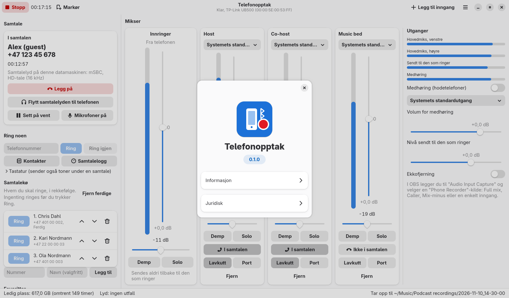
