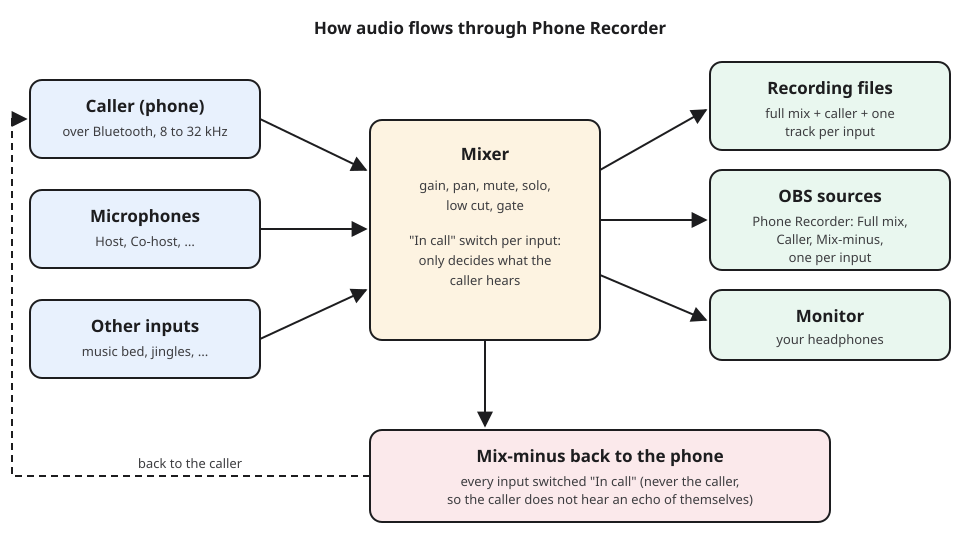
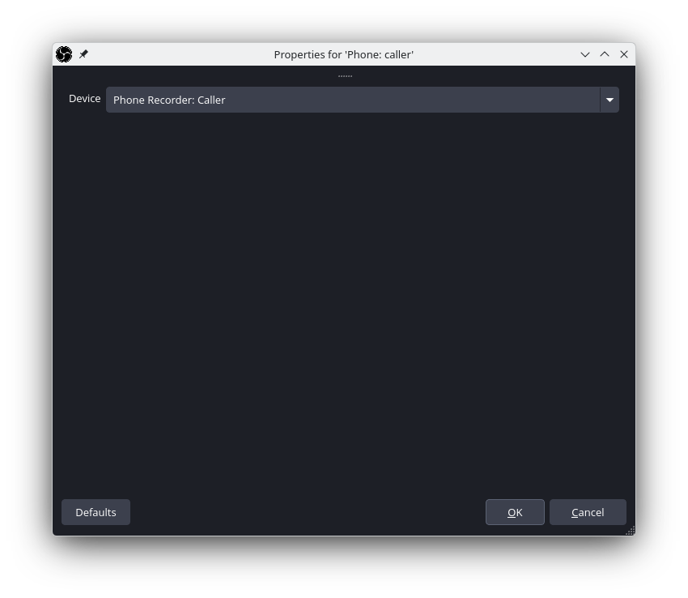
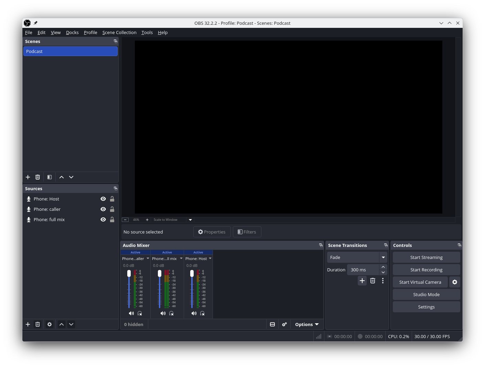
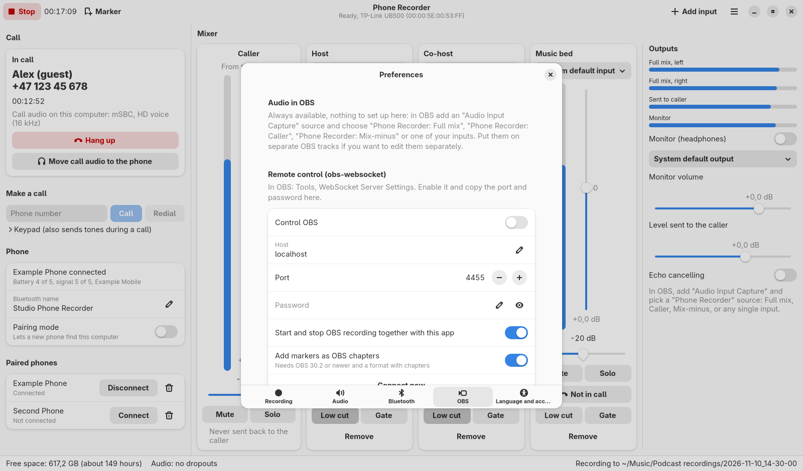

# Using Phone Recorder with OBS Studio

Phone Recorder and OBS work together in two ways, and you can use either or
both:

1. **Audio sources (always on):** while Phone Recorder runs, its audio shows
   up in OBS as ordinary input devices. Nothing needs to be set up in Phone
   Recorder.
2. **Remote control (optional):** Phone Recorder starts and stops the OBS
   recording together with its own, and adds its markers as OBS chapters.

Written for OBS Studio 30 and newer on Linux. Menu names are those of the
English OBS interface.

---

## 1. The audio sources

While Phone Recorder runs, these sources exist on your system:

| Source name in OBS | What you hear |
|--------------------|---------------|
| **Phone Recorder: Full mix** | the finished stereo mix: caller and all inputs |
| **Phone Recorder: Caller** | only the caller |
| **Phone Recorder: Mix-minus** | what the caller hears (all inputs switched "In call") |
| **Phone Recorder: *input name*** | one per input, for example "Phone Recorder: Host" |

Each single-input source carries that input **whatever its Mute or "In call"
setting is**, so you can mute a microphone for the caller and still have it
in OBS.

### Add a source

1. Start Phone Recorder first, so its sources exist.
2. In OBS, in the **Sources** panel, click **+** and choose
   **Audio Input Capture (PulseAudio)**. (On PipeWire systems this is still
   the right one; PipeWire answers for PulseAudio.)
3. Give it a name, for example "Phone: caller", and click **OK**.
4. In **Device**, choose the Phone Recorder source you want, then **OK**.

The source appears in the OBS **Audio Mixer** with its own meter and volume:

### Which setup should I use?

**Simple (one track):** add only **Phone Recorder: Full mix**. You get the
same mix as Phone Recorder's `01-full-mix.wav`, ready for a video.

**For editing later (several tracks):** add **Phone Recorder: Caller** and one
source per input (for example **Phone Recorder: Host**), and put each on its
own OBS audio track:

1. **Edit, Advanced Audio Properties** (or the gear icon in the Audio Mixer).
2. For each source, tick only its own track: caller on track 2, host on
   track 3, and so on. Keep the full mix on track 1 if you also want a ready
   mix.
3. **Settings, Output**, set **Output Mode** to **Advanced**, open the
   **Recording** tab and tick the same **Audio Track** numbers.
4. Record to **MKV** or **Hybrid MP4**: both keep several audio tracks.

Phone Recorder's own recording already has these tracks as separate WAV
files, so the OBS tracks are mainly useful when you edit the video in a video
editor.

### Avoid doubled audio

Capture each sound only once:

- Do **not** also add your microphone directly in OBS when it is already an
  input in Phone Recorder; use "Phone Recorder: *input name*" instead.
- OBS's **Desktop Audio** captures everything your computer plays,
  including Phone Recorder's headphone monitor. If you use the Phone Recorder
  sources, mute or disable Desktop Audio (**Settings, Audio, Global Audio
  Devices, Desktop Audio: Disabled**), or play the monitor on a device OBS
  does not capture.

### What is Mix-minus for?

**Phone Recorder: Mix-minus** is exactly what the caller hears. It is useful
when a second remote guest joins through another app (for example a video
call): send the mix-minus to that app as its microphone, so the guest hears
you and the phone caller, but not themselves.

---

## 2. Remote control (start and stop together)

With remote control on, pressing **Record** in Phone Recorder also starts the
OBS recording, **Stop** stops both, and every **Marker** becomes an OBS
chapter.

### In OBS

1. **Tools, WebSocket Server Settings.**
2. Tick **Enable WebSocket server**.
3. Note the **Server Port** (normally 4455). Click **Show Connect Info** to
   see the password, or set your own.
4. Click **OK**.

### In Phone Recorder

1. **Menu (☰), Preferences, OBS.**
2. Turn on **Control OBS**.
3. Enter **Host** (`localhost` when OBS runs on the same computer), **Port**
   and **Password**, pressing Enter after each.
4. Choose **Connect now**. The message "Connected to OBS" confirms it.

Options:

- **Start and stop OBS recording together with this app.**
- **Add markers as OBS chapters.** Needs OBS 30.2 or newer and the
  **Hybrid MP4** recording format, which supports chapters.

If OBS is closed, Phone Recorder keeps working on its own. Choose
**Connect now** again after starting OBS.

---

## 3. Checklist for a recording session

1. Start Phone Recorder; check that the phone is connected (**Phone** section).
2. Start OBS; check that the Phone Recorder sources show meters in the Audio
   Mixer when someone speaks.
3. Talk into each microphone and set its level in Phone Recorder to about
   -12 dB.
4. Make or answer the call; check the codec shown in the call card
   ("HD voice" or better is good).
5. Press **Record** in Phone Recorder. With remote control on, OBS starts too.
6. Add markers (Ctrl+M or F9) at moments you want to find later.
7. Press **Stop**. Phone Recorder shows where its files are; OBS saves its
   recording as usual.

## Troubleshooting

| Problem | What to do |
|---------|------------|
| The Phone Recorder devices are missing in OBS | Start Phone Recorder before opening the source properties, then reopen the **Device** list. |
| An OBS source shows no meter | Check the matching strip in Phone Recorder shows a level. Note that mute does not silence single-input sources, but the full mix follows mute. |
| Everything is twice as loud or has an echo in OBS | A sound is captured twice: see [Avoid doubled audio](#avoid-doubled-audio). |
| "OBS: wrong OBS websocket password" | Copy the password again from **Tools, WebSocket Server Settings, Show Connect Info**. |
| "OBS: disconnected from OBS" | OBS was closed or its WebSocket server is off. Start OBS, then **Connect now**. |
| No chapters in the OBS recording | Use OBS 30.2 or newer and the Hybrid MP4 format. |
