# Phone Recorder user guide

Phone Recorder records phone calls over Bluetooth for podcasts. Your computer
connects to the phone the way a car kit does, so any call on the phone comes
through the app: normal calls and calling apps such as WhatsApp or Signal.
The caller and every microphone are recorded on separate tracks, and all of
them are also available to OBS.

Contents:

1. [What you need](#1-what-you-need)
2. [First start: choose the Bluetooth adapter](#2-first-start-choose-the-bluetooth-adapter)
3. [Pair your phone](#3-pair-your-phone)
4. [The main window](#4-the-main-window)
5. [Calls](#5-calls)
   - [Contacts](#contacts)
6. [The mixer](#6-the-mixer)
7. [Recording](#7-recording)
8. [Preferences](#8-preferences)
9. [Keyboard shortcuts](#9-keyboard-shortcuts)
10. [Accessibility and language](#10-accessibility-and-language)
11. [Troubleshooting](#11-troubleshooting)
12. [Where files are stored](#12-where-files-are-stored)

Using OBS? See the separate [OBS guide](obs-guide.md).

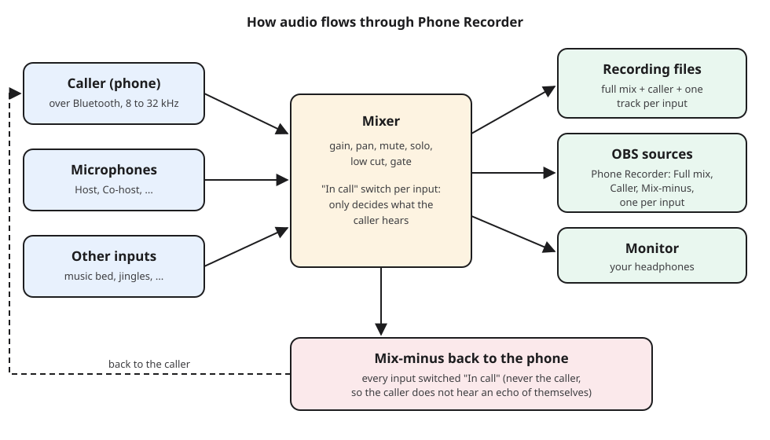

---

## 1. What you need

- **A Linux computer** with PipeWire (standard on current distributions).
- **A Bluetooth adapter.** A separate USB dongle is best, because the app takes
  full control of the adapter it uses: other Bluetooth devices on that adapter
  (headphones, mouse, keyboard) disconnect while the app runs. A cheap,
  well-supported choice is the TP-Link UB500. The built-in adapter works too.
  See the hardware table in the [README](../README.md#bluetooth-adapters).
- **Headphones** for monitoring. With speakers the caller may hear an echo
  (there is an echo canceller for that case, see [the mixer](#6-the-mixer)).
- **One-time setup** (asks for your password):

  ```sh
  scripts/install-udev-rule.sh
  ```

  This lets your user drive USB Bluetooth adapters without root rights.
  Building and installing the app is described in [BUILD.md](../BUILD.md).

### Which phones work

Any phone that works with a car kit or a Bluetooth headset: Android phones,
iPhones and most other mobile phones (Bluetooth Hands-Free Profile). The
contact list needs the phone to share its address book (Phone Book Access
Profile), which Android phones and iPhones do after you allow it; some
older phones cannot, and then the app simply works without contacts.

### About sound quality

Bluetooth calls are limited by the phone link itself, no matter what the app
records at:

| Shown during the call | Sample rate | Typical phones                  |
|-----------------------|-------------|---------------------------------|
| CVSD, narrowband      | 8 kHz       | old phones or adapters          |
| mSBC, HD voice        | 16 kHz      | most phones from the last decade |
| LC3-SWB, super wideband | 32 kHz    | newer phones                    |

The app picks the best one the phone and the adapter both support. Your own
microphones are recorded at full quality (48 kHz, 32-bit).

---

## 2. First start: choose the Bluetooth adapter

On the first start the app asks which Bluetooth adapter to use.

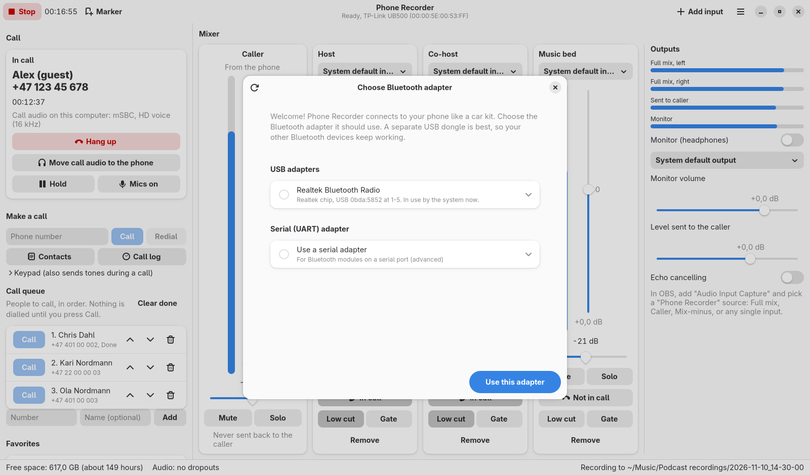

1. Pick your adapter. Each entry shows the chip, the USB ID and whether the
   system uses it right now.
2. Optional: open the entry to choose the **Mode**:
   - **Direct USB (recommended):** the app talks to the adapter itself and
     loads its firmware.
   - **Kernel driver, raw access:** for chips whose firmware only the Linux
     kernel can load (MediaTek, Intel AX210 and newer, Qualcomm). Needs the
     helper: run `scripts/setup-userchan-helper.sh` once.
3. Choose **Use this adapter**. If the system is using it, the app first
   warns that other Bluetooth devices on it will disconnect. The app then
   restarts once.

While the app runs, that adapter belongs to the app. When you close the app,
it is given back to the system, also if the app should ever crash.

To switch adapters later: **Menu (☰), Choose Bluetooth adapter**.

---

## 3. Pair your phone

1. In the **Phone** section, turn on **Pairing mode**.
2. On the phone, open the Bluetooth settings and choose the app's name
   (by default "Phone Recorder", see [Bluetooth name](#bluetooth-name)).
3. The app shows a code. Check that the phone shows **the same code**, then
   choose **Pair** on both the phone and the computer.

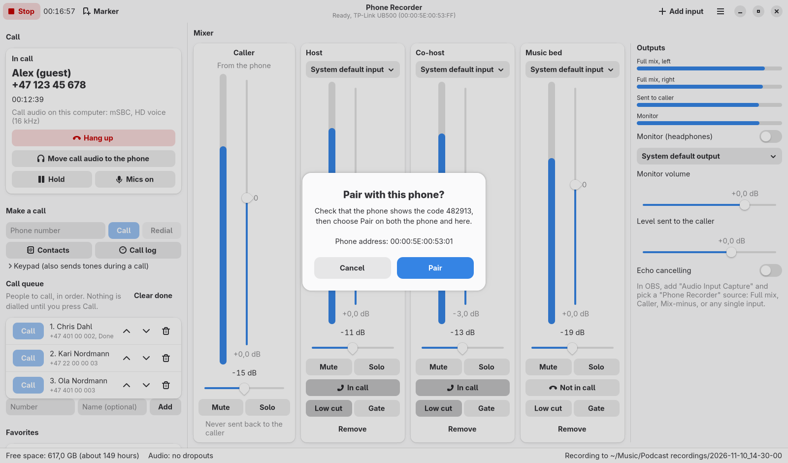

Older phones may ask for a PIN instead. Type the same PIN on both sides,
for example 0000:

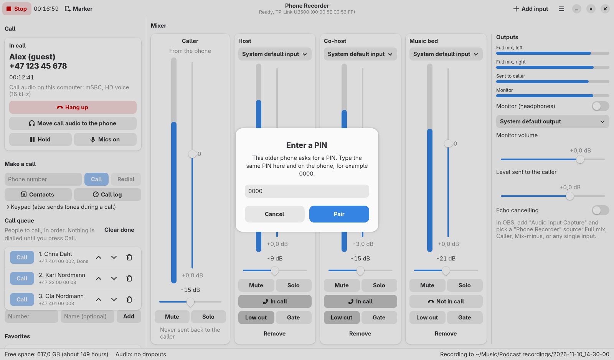

After pairing, the phone appears under **Paired phones**. Next time it
connects by itself when the app starts (or use **Connect** in the list).
**Forget** (the bin icon) removes a phone; it must then be paired again.

### Bluetooth name

The name phones see can be changed in the **Phone** section: select the
**Bluetooth name** field, type a new name and press Enter. It changes right
away. Phones that are already paired may show the old name until they
connect again.

---

## 4. The main window


- **Header bar:** **Record** / **Stop** with the recording time, **Marker**,
  **Add input** and the main menu (☰). The subtitle shows the Bluetooth status.
- **Left side:** the current call, **Make a call**, the **Phone** section
  (connection, battery, signal, Bluetooth name, pairing mode) and **Paired
  phones**.
- **Right side:** the **Mixer** with one strip per source and the
  **Outputs** section.
- **Status line at the bottom:** free disk space with the recording time
  left, an audio health indicator ("no dropouts" or a count) and where the
  current recording is saved.

---

## 5. Calls

- **Incoming call:** the call card shows the caller's name or number and
  **Answer** and **Decline** (Ctrl+Shift+A, Ctrl+Shift+H). If the window is
  in the background, a desktop notification with an Answer button appears.
- **Make a call:** type the number under **Make a call** and press Enter or
  **Call**. **Redial** calls the last number again. The **Keypad** sends tones
  during a call (for menus like "press 1").
- **During the call:** the card shows the call time and the codec, for
  example "mSBC, HD voice (16 kHz)". **Hang up** ends the call.
- **Call audio on the phone or the computer:** **Move call audio to the
  phone** hands the audio back to the handset (the call continues);
  **Move call audio to the computer** brings it back (Ctrl+Shift+T). The app
  brings the audio to the computer by itself when a call starts.
- **Call waiting:** if a second call comes in during a call, the card shows
  "Call waiting" with the new caller's name or number and, below it, the call
  you are in. **Answer** puts the current call on hold and takes the new one;
  **Decline** rejects only the new call.

Closing the app during a call does not end the call; it continues on the
phone.

### Contacts

When a phone connects, the app downloads its address book, so you can call
people by name and see who is calling even when the phone only sends a
number. The contacts are kept only on this computer, in a file only your
user can read, and are deleted when you **Forget** the phone.

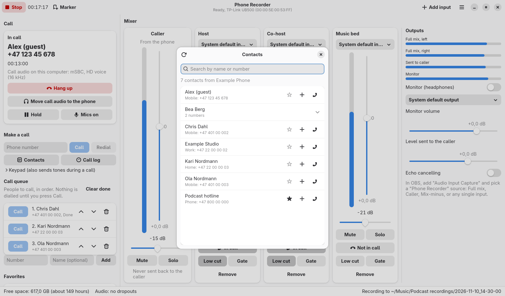

- Open it with **Contacts** under **Make a call**, or Ctrl+K.
- Type in the search field to find a name or a part of a number.
- Click the call button next to a number to call it. Contacts with several
  numbers open to show them all.
- The refresh button (top left) downloads the address book again.

The phone must allow this the first time:

- **Android:** the phone asks whether to share contacts (and call history)
  with "Phone Recorder": choose **Allow**. If you missed the question, open
  the phone's Bluetooth settings, tap the gear next to Phone Recorder and turn
  on **Contacts** (sometimes called **Contact sharing**).
- **iPhone:** open **Settings, Bluetooth**, tap **(i)** next to Phone
  Recorder and turn on **Sync Contacts**. Then choose refresh in the Contacts
  window.

To stop downloading contacts, turn off **Download the phone's contacts** in
Preferences, Bluetooth.

---

## 6. The mixer

Each source has a strip. The **Caller** strip is always first.

| Control | What it does |
|---------|--------------|
| Name (click to rename) | Used for the recording file and the OBS source name. |
| Input device | Which microphone or input the strip uses. "System default input" follows your desktop setting. |
| Level meter and number | Peak level. Aim for about -12 dB when speaking. "CLIP" means too loud: turn the volume down. |
| Volume slider | Gain of the strip, -30 to +24 dB. |
| Left-right slider | Position in the stereo mix. |
| **Mute** | Takes the strip out of the mix and the call. Its own OBS source and recording track keep the sound. |
| **Solo** | Listen only to soloed strips on the monitor. Changes nothing in the recording, the call or OBS. |
| **In call / Not in call** | Whether the caller hears this input. **It never removes the input from OBS or the recording.** |
| **Low cut** | Removes rumble and handling noise below 80 Hz. |
| **Gate** | Turns the strip down when nobody speaks into it. |
| **Remove** | Removes the input (not possible while recording). |

The caller is **never** sent back to the phone, so the caller never hears an
echo of themselves. This is called a mix-minus.

**Add input** (Ctrl+I) adds another microphone or input, for example a music
player you want on its own track.

### Outputs

- **Meters:** full mix (left and right), what is sent to the caller, and the
  monitor.
- **Monitor (headphones):** turn on, choose the output device and set its
  volume. The monitor plays the full mix, or only the soloed strips.
- **Level sent to the caller:** overall volume of what the caller hears.
- **Echo cancelling:** only needed when the caller is played on speakers.

---

## 7. Recording

- Press **Record** (Ctrl+R) to start and **Stop** to finish. A message tells
  you where the recording was saved, with an **Open folder** button.
- Each recording gets its own folder, named by date and time, for example
  `~/Music/Podcast recordings/2026-11-10_14-30-00/`.
- Inside are one file per source, all exactly in step:

  ```
  01-full-mix.wav        the stereo mix
  02-caller.wav          the caller
  03-host.wav            each input, named after its strip
  04-co-host.wav
  markers-audacity.txt   markers for Audacity (File, Import, Labels)
  chapters.txt           markers as chapter times
  ```

- **Markers** (Ctrl+M or F9) mark a point in the recording, for example a good
  quote. They are stored in the WAV files as cue points, as an Audacity label
  file and as a chapter list.
- **Automatic recording:** in Preferences, recording can start by itself when
  a call starts and stop when it ends.
- Recordings are safe if the computer crashes or loses power: the files stay
  readable up to the last moment.
- The status line warns when less than 15 minutes of disk space are left.

Inputs cannot be added or removed while recording.

---

## 8. Preferences

Open with **Menu (☰), Preferences** or Ctrl+comma.

### Recording

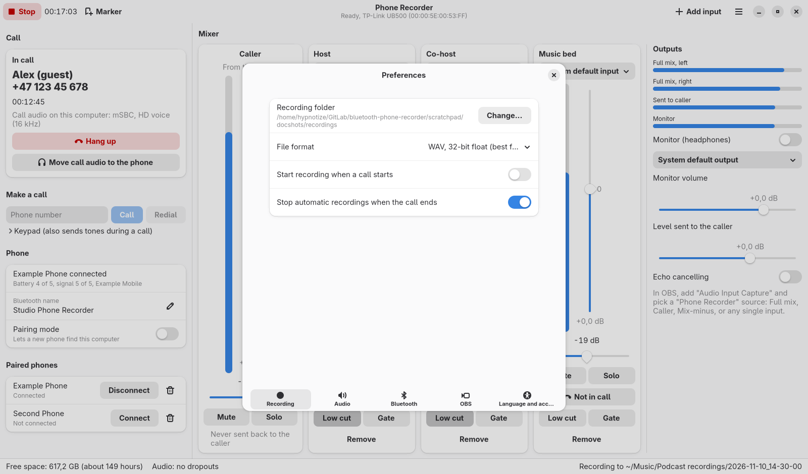

- **Recording folder.**
- **File format:** WAV 32-bit float (best for editing, default), WAV 24-bit,
  FLAC 24-bit (lossless, about half the size) or Opus (small, for sharing).
- **Start recording when a call starts** and **Stop automatic recordings when
  the call ends.**

### Audio

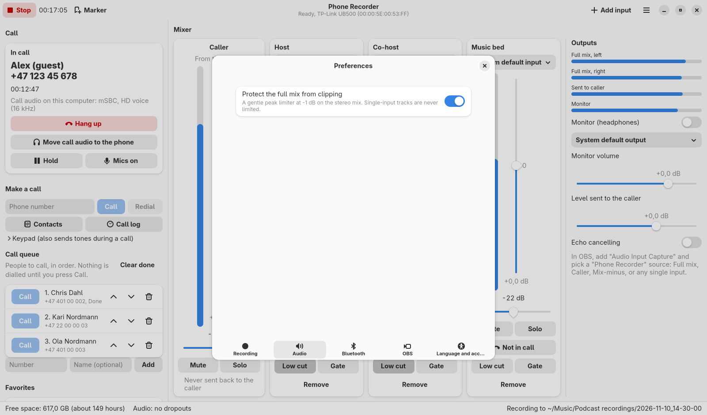

- **Protect the full mix from clipping:** a gentle limiter on the stereo mix.
  Single-input tracks are never limited.

### Bluetooth

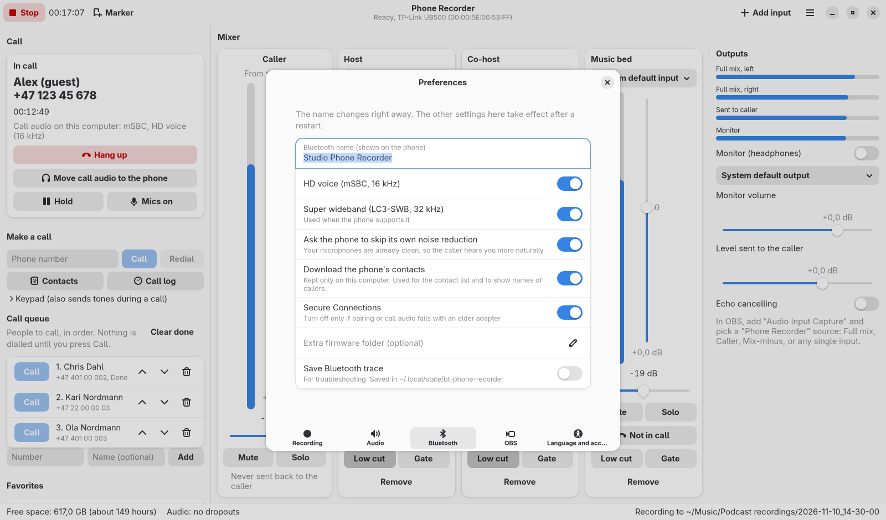

- **Bluetooth name** (changes right away).
- **HD voice** and **Super wideband:** allow the better codecs. Leave on.
- **Ask the phone to skip its own noise reduction:** your microphones are
  already clean, so the caller hears you more naturally.
- **Download the phone's contacts:** see [Contacts](#contacts).
- **Secure Connections:** turn off only if pairing or call audio fails with an
  older adapter.
- **Extra firmware folder:** for adapters whose firmware is not in the system.
- **Save Bluetooth trace:** for troubleshooting (see below).

Apart from the name, these take effect after a restart.

### OBS

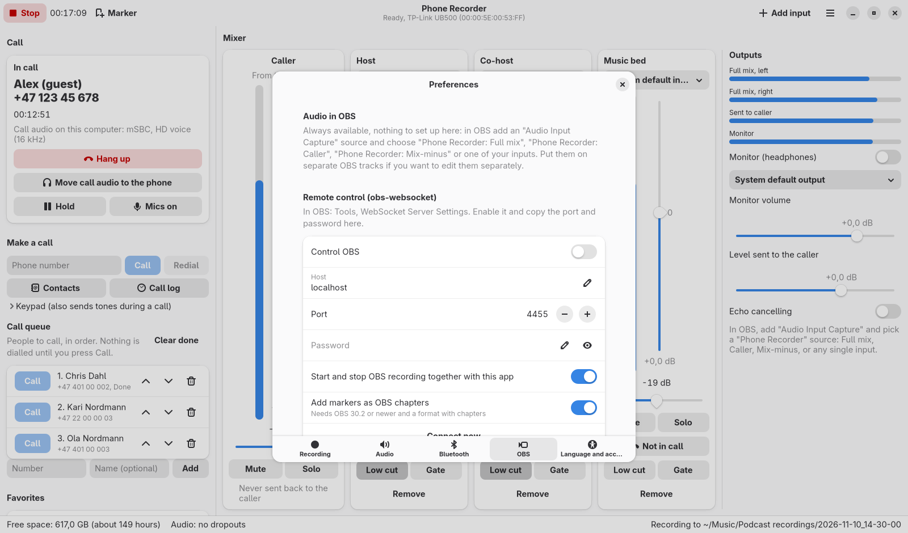

See the [OBS guide](obs-guide.md).

### Language and accessibility

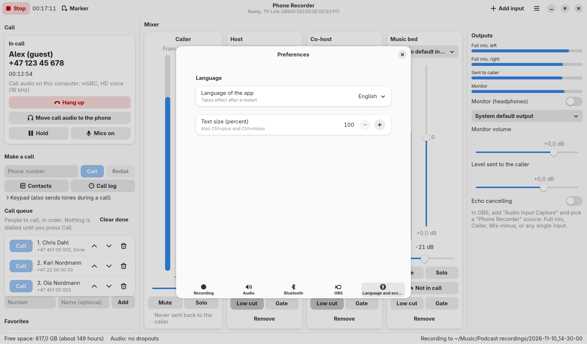

- **Language of the app:** System default, English or Norsk bokmål. Takes
  effect after a restart; the message that appears has a **Restart now**
  button.
- **Text size:** 100 to 200 percent, on top of your desktop setting.

---

## 9. Keyboard shortcuts

Press F1 (or Ctrl+?) to see them in the app.

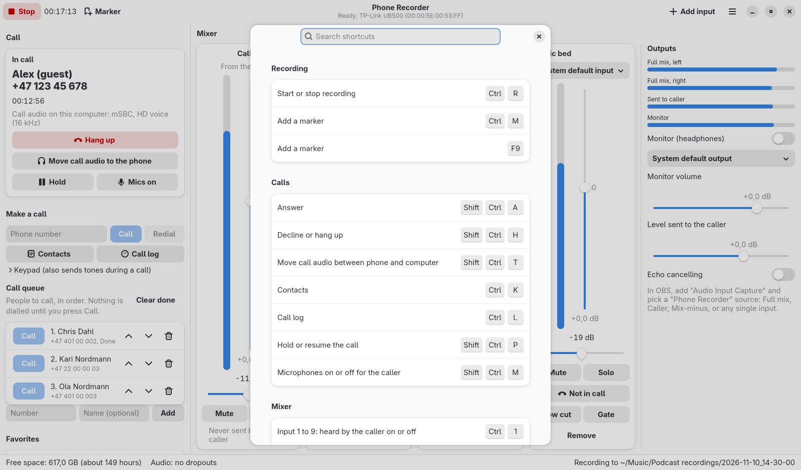

| Keys | Action |
|------|--------|
| Ctrl+R | Start or stop recording |
| Ctrl+M or F9 | Add a marker |
| Ctrl+Shift+A | Answer |
| Ctrl+Shift+H | Decline or hang up |
| Ctrl+Shift+T | Move call audio between phone and computer |
| Ctrl+K | Contacts |
| Ctrl+1 to Ctrl+9 | Input 1 to 9: heard by the caller on or off |
| Alt+1 to Alt+9 | Input 1 to 9: mute on or off |
| Ctrl+I | Add an input |
| Ctrl+comma | Preferences |
| Ctrl+plus, Ctrl+minus, Ctrl+0 | Larger, smaller, normal text |
| F10 | Main menu |
| Ctrl+Q | Quit |

Everything else works with Tab, Shift+Tab, the arrow keys, Enter, Space and
Esc.

---

## 10. Accessibility and language

- Every control has a name for screen readers, and important events are read
  out: incoming calls, call connected and ended, recording started and
  stopped, pairing codes.
- Nothing depends on colour alone: switches show text and icons, meters show
  numbers.
- Text size and language are in Preferences (see above).
- The full statement, in English and Norwegian, is in
  [ACCESSIBILITY.md](../ACCESSIBILITY.md).

---

## 11. Troubleshooting

| Problem | What to do |
|---------|------------|
| The phone does not find the app | Turn on **Pairing mode**, then search again on the phone. |
| "The chosen Bluetooth adapter was not found" | Plug the adapter in, or choose another one in **Choose Bluetooth adapter**. |
| "Adapter failed" | Save an adapter report (**Menu, Save adapter report**) and try the other mode for the adapter, or another adapter. |
| A call connects but no audio arrives | The app says so. In kernel driver mode, try Direct USB. Otherwise try another adapter. |
| Only narrowband (8 kHz) | The adapter or the phone has no wideband support. Try another adapter. |
| The caller hears an echo | Use headphones, or turn on **Echo cancelling**. |
| No contacts | Android: allow contact sharing for Phone Recorder in the phone's Bluetooth settings. iPhone: Settings, Bluetooth, (i), turn on **Sync Contacts**. Then choose refresh in the Contacts window. |
| Callers show only a number | The number is not in the phone's address book, or contacts are not downloaded (see above). |
| Clicks or dropouts | The status line counts them. Close heavy programs; check the disk is not full. |
| Bluetooth is still gone from the system after the app closed (rare) | Run `bt-phone-recorder --release-adapters`. |

For a detailed problem report:

1. Turn on **Preferences, Bluetooth, Save Bluetooth trace** and restart the app.
2. Reproduce the problem.
3. Use **Menu, Save adapter report**, and attach it together with the newest
   `.pklg` file from `~/.local/state/bt-phone-recorder/` (it opens in Wireshark).

---

## 12. Where files are stored

| Path | Contents |
|------|----------|
| `~/Music/Podcast recordings/` | your recordings (changeable) |
| `~/.config/bt-phone-recorder/` | settings and remembered phone names |
| `~/.local/share/bt-phone-recorder/` | pairing keys and the downloaded address book (readable only by you) |
| `~/.local/state/bt-phone-recorder/` | log file and Bluetooth traces |
| `~/.cache/bt-phone-recorder/` | unpacked Bluetooth firmware (recreated when needed) |

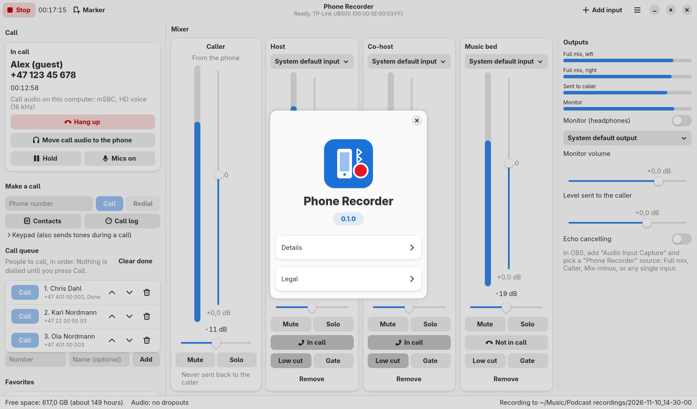
